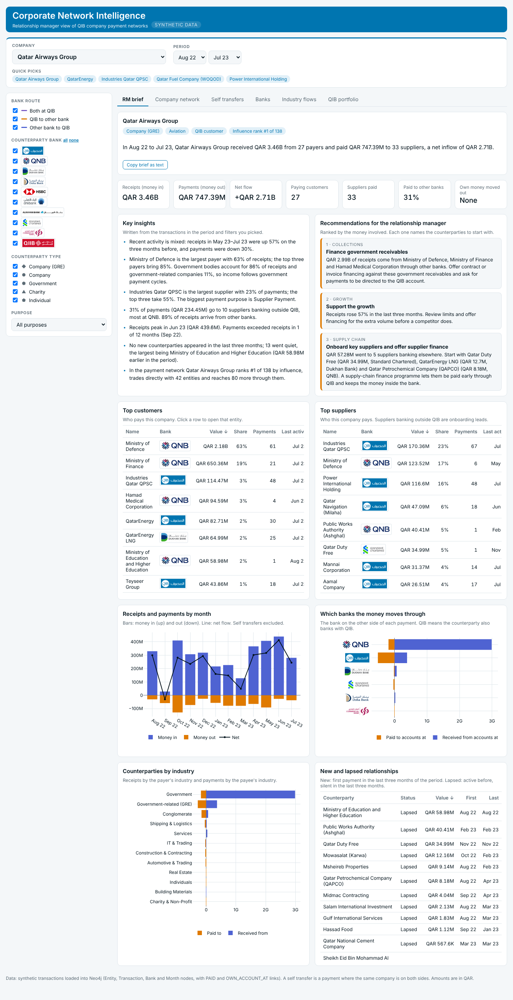

# Corporate Network Intelligence

A relationship-manager view of company payment networks, built on **synthetic** Qatar Islamic Bank (QIB) transaction data. Every transaction has a QIB account on one side; counterparties are real Qatar companies, government bodies and charities banking at QIB or other Qatar banks. All amounts and transactions are made up.

**Live dashboard:** https://atulchandorkar.github.io/network-dashboard/ (published from a separate repository that holds only the built page)



## What it shows
Pick a company at the top; every tab follows it.
- **RM brief:** headline, KPIs, written insights, ranked recommendations, top customers and suppliers, banks and industries on the other side, new and lapsed relationships.
- **Company network:** first- and second-level payment network (QIB customers blue, others green; shape = entity type). Hover any node or line for value, payment count and route.
- **Self transfers:** the company's money moving between its QIB account and its own accounts at other banks.
- **Banks:** the banks on the other side of the company's payments (or all QIB customers), with a drill-down per bank.
- **Industry flows:** where the company's money comes from and goes to by industry, or industry-to-industry flows across the portfolio.
- **QIB portfolio:** the largest relationships and the most influential entities (PageRank).

Insights and recommendations are rule-based (thresholds and templates over the filtered transactions), not a trained model; the influence rank is PageRank computed with NetworkX.

## Repository layout
| Path | What it is |
|---|---|
| `01_data/synthetic/qib_synthetic_transactions.csv` | 5,453 synthetic transactions, 46 fields (Aug 2022 – Jul 2023), incl. 320 self transfers |
| `01_data/processed/` | JSON exports from Neo4j used by the dashboards, and a Neo4j 5.26 database dump |
| `03_code/scripts/gen.py`, `write.py` | Data generator (`PYTHONHASHSEED=0 python gen.py && python write.py`) |
| `03_code/src/graph/` | Neo4j loader, graph analytics/export (PageRank, betweenness, Louvain) and business Cypher queries |
| `03_code/config/neo4j/docker-compose.yml` | Local Neo4j |
| `03_code/src/app/` | Plotly Dash version of the dashboard (reads Neo4j, or the JSON exports when no database is set) |
| `05_visualizations/explorer_src/` | Source of the static dashboard: `template.html` + `build.py` → `docs/index.html` |
| `docs/index.html` | The built dashboard, one self-contained HTML file (copied to the `network-dashboard` repository for publishing) |
| `08_documentation/` | Data dictionary and graph-model/dashboard methodology |

## Run it
Static dashboard: open `docs/index.html` in a browser, or rebuild it with `python 05_visualizations/explorer_src/build.py`.

Dash app:
```
cd 03_code/src/app
python -m venv .venv && source .venv/bin/activate
pip install -r requirements.txt
python app.py            # http://127.0.0.1:8050 ; set NEO4J_URI / NEO4J_USER / NEO4J_PASSWORD to read from Neo4j
```

Neo4j: `docker compose -f 03_code/config/neo4j/docker-compose.yml up -d` with `NEO4J_PASSWORD` set in your shell, then load with `03_code/src/graph/load_to_neo4j.py` (see `08_documentation/methodology`).

## Notes
- Data is synthetic and for demonstration only. Bank logos are used only to identify each bank.
- No passwords or keys are stored in this repository.
